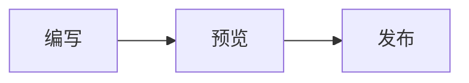

# Nexusdown

基于 CodeMirror 6 的 Markdown 即时预览编辑器，提供 Vue 3 组件、可独立使用的编辑引擎，以及可在服务端运行的 Markdown 渲染器。文档内容始终以 Markdown 文本保存；编辑时，光标所在区域显示源码，其他区域呈现格式预览。

[GitHub](https://github.com/NexusMC-CN/nexusdown) · [使用示例](https://github.com/NexusMC-CN/nexusdown/tree/main/examples) · [问题反馈](https://github.com/NexusMC-CN/nexusdown/issues)

## Vue 快速开始

安装组件及编辑引擎所需的 peer 依赖：

```bash
npm install @nexusmc-cn/nexusdown vue @codemirror/autocomplete @codemirror/commands @codemirror/lang-markdown @codemirror/language @codemirror/state @codemirror/view @lezer/common @lezer/highlight @lezer/markdown
```

CodeMirror 使用 6.x，Lezer 使用 1.x。这些编辑依赖在包中标记为可选，使用 `/editor` 或 `/cm` 时需要安装，包括 `@codemirror/autocomplete`。

在 Vue 单文件组件中使用：

```vue
<script setup lang="ts">
import { ref } from 'vue'
import { NexusdownEditor } from '@nexusmc-cn/nexusdown/editor'
import '@nexusmc-cn/nexusdown/editor/style.css'

const markdown = ref('# 你好，Nexusdown\n\n开始编写 **Markdown**。')
</script>

<template>
  <NexusdownEditor v-model="markdown" class="editor" />
</template>

<style scoped>
.editor {
  --nd-editor-height: 420px;
}
</style>
```

`v-model` 的值是 Markdown 字符串，可直接用于草稿保存和提交。组件包含格式工具栏，并在卸载时销毁编辑器。组件样式独立发布，请在应用中引入一次 `editor/style.css`。

编辑区默认高度为 `420px`，可通过 `--nd-editor-height` 调整，例如 `min(65vh, 560px)`。颜色、字体等通过 `--nd-*` CSS 变量配置，例如 `--nd-editor-bg`、`--nd-text`、`--nd-brand`、`--nd-caret`、`--nd-font-body` 和 `--nd-font-size`；主题切换由应用设置这些变量。

### 组件接口

| Prop | 类型 | 说明 |
| --- | --- | --- |
| `modelValue` | `string` | 必填，Markdown 内容；通过 `v-model` 双向同步 |
| `mathRenderer` | `KatexLike` | 可选，行内与块级数学公式的渲染器 |
| `mentionCandidates` | `() => Promise<MentionCandidate[]>` | 可选，工具栏选择器和输入 `@` 时的提及候选 |
| `mentions` | `MentionResolutions` | 可选，按 slug 索引的提及解析结果，用于显示标题、摘要等信息 |

组件发出 `update:modelValue(value: string)` 事件，并暴露 `view`，供组件引用访问当前 `EditorView`；挂载完成前为 `null`。功能配置在编辑器挂载时读取，更换渲染器或解析数据时可通过 Vue 的 `key` 重新挂载组件。

`/editor` 还具名导出 `NexusdownToolbar`，可用于自定义编辑器布局。它接收 `view: EditorView | null` 和可选的 `mentionCandidates`。

## 渲染 Markdown

### 流程图与其他图表

`mermaid` 代码块由内置的 [Pele](https://github.com/obsidianmd/pele) 渲染为 SVG，继续使用 Mermaid 语法：

````markdown

````

顶层图表支持点击编辑源码，输出侧支持同步服务端渲染。语法错误时保留源码。多片段 ID、主题和兼容范围见 [图表说明](./docs/pele-diagrams.md)。

### 渲染接口

展示已保存的内容时，使用 `/render`：

```ts
import { renderMarkdown } from '@nexusmc-cn/nexusdown/render'

const html = renderMarkdown('# 你好，**世界**')
// <h1>你好，<strong>世界</strong></h1>
```

`renderMarkdown(markdown, options?)` 同步返回 HTML 字符串，不依赖 DOM，也不发起网络请求，可在 Node、Nuxt 或 Astro 的服务端渲染阶段调用。空字符串或纯空白输入返回 `''`。仅使用 `/render` 时，无需安装 CodeMirror、Lezer 或 KaTeX。

Vue 展示示例：

```vue
<script setup lang="ts">
import { computed, ref } from 'vue'
import { renderMarkdown } from '@nexusmc-cn/nexusdown/render'
import '@nexusmc-cn/nexusdown/dialect.css'

const markdown = ref('# 阅读内容\n\n这是一段 **Markdown**。')
const html = computed(() => renderMarkdown(markdown.value))
</script>

<template>
  <article class="markdown-body" v-html="html" />
</template>

<style>
.markdown-body {
  line-height: 1.8;
  overflow-wrap: anywhere;
}
.markdown-body img {
  max-width: 100%;
}
.markdown-body pre {
  overflow-x: auto;
}
</style>
```

`dialect.css` 提供共享的提及胶囊和卡片样式。普通正文排版，以及链接卡片、轮播等展示样式，由应用补充。需要复用代码块标题栏、公式和嵌入内容的现有样式时，可以额外引入 `@nexusmc-cn/nexusdown/cm/theme.css`，该文件也包含编辑器主题规则。

### 安全与外部数据

`renderMarkdown` 不做 HTML 消毒。默认配置会转义输入中的原始 HTML，并使用 markdown-it 的链接校验；这些处理不能替代应用的内容安全策略。接受用户提交的内容时，应在插入页面前按应用策略消毒输出；编辑器保存的 Markdown 同样可能来自用户输入。

`options.data` 可传入预先获取的链接和提及数据，`options.plugins` 可添加 markdown-it 插件。应用需要校验外部数据中的 URL，尤其是提及结果的 `href`，并信任所安装的插件和注入的渲染器。短链跳转、网页元数据和提及查询均由应用完成，库只读取提供的数据。

## 支持的内容

| 内容 | 用法与边界 |
| --- | --- |
| Markdown 与 GFM | 标题、强调、删除线、行内代码、代码块、引用、列表、任务列表、链接、图片、表格、分隔线和硬换行 |
| 高亮 | `==文字==` |
| 自动链接 | 协议链接、`www.` 链接和邮箱；普通裸域名不会自动转成链接 |
| Emoji | 支持内置的 `:shortcode:`，例如 `:smile:`；代码中的短代码保留原样 |
| 数学公式 | 行内 `$E = mc^2$`；块级使用语言为 `math` 的代码围栏，KaTeX 按需接入 |
| 提及 | `@slug`、`@slug#fragment`；可接入候选与解析数据，独占一段时显示卡片 |
| 嵌入 | 支持哔哩哔哩视频、抖音视频、网易云歌曲与歌单的已知链接，以及 `embed` 围栏；短链需要先提供解析结果 |
| 图片轮播 | 渲染器会将同一顶层段落内的两张及以上连续图片组合为轮播结构；图片间不能有空行，展示样式由应用提供 |
| 链接卡片 | 渲染器可根据 `data.links` 中的元数据，将独占一段的链接显示为卡片 |

即时预览保留 Markdown 源码作为编辑内容。编辑器和渲染器分别解析 Markdown；自定义语法需要同时配置编辑侧的 CodeMirror 扩展和渲染侧的 markdown-it 插件。`renderMarkdown` 的插件在内置规则之后安装，可覆盖规则；反复渲染时复用同一个插件数组可复用解析器。

## Nuxt 与 Astro

### Nuxt

在 Nuxt 页面中可直接使用上面的 Vue 组件。在 `nuxt.config.ts` 中统一加载样式：

```ts
export default defineNuxtConfig({
  css: ['@nexusmc-cn/nexusdown/editor/style.css'],
})
```

编辑器组件在服务端生成容器，在客户端挂载后创建 CodeMirror 视图。若页面需要在服务端展示正文，另用 `/render` 生成内容 HTML。

完整示例：[Nuxt SSR](https://github.com/NexusMC-CN/nexusdown/tree/main/examples/nuxt-ssr)。

### Astro

在已启用 `@astrojs/vue` 的 Astro 项目中，将快速开始示例保存为 Vue 组件，再选择水合时机：

```astro
---
import EditorDemo from '../components/EditorDemo.vue'
---

<EditorDemo client:load />
```

也可以使用 `client:visible`，在组件进入视口后启用交互。静态正文可在 Astro frontmatter 中调用 `renderMarkdown`，再通过 `set:html` 输出；同样需要遵循上述消毒与样式要求。

完整示例：[Astro + Vue](https://github.com/NexusMC-CN/nexusdown/tree/main/examples/astro-vue)。

## 独立使用编辑引擎

不使用 Vue 时，可在浏览器中通过 `/cm` 挂载编辑器：

```ts
import { mountEditor, setEditorValue } from '@nexusmc-cn/nexusdown/cm'
import '@nexusmc-cn/nexusdown/cm/theme.css'

const parent = document.querySelector<HTMLElement>('#editor')!
const view = mountEditor({
  parent,
  doc: '# 开始写作',
  onDocChange(markdown) {
    console.log(markdown)
  },
})

// 从外部载入另一份文档
setEditorValue(view, '# 新的草稿')

// 页面或组件卸载时调用 view.destroy()
```

`mountEditor` 返回 CodeMirror 的 `EditorView`，包含 Markdown 解析、即时预览、自动换行、多选区、撤销重做及基础快捷键。它还接收可选的 `mathRenderer`、`mentions` 和 `mentionCandidates`。

需要自行组装 CodeMirror 时，使用 `nexusdown(options)` 获取扩展。代码块语言高亮可安装 `@codemirror/language-data`，将其 `languages` 传给 `nexusdown({ codeLanguages: languages })`。组合第三方扩展时，请保持 CodeMirror 依赖解析到同一份模块实例，避免扩展对象不兼容。

## 可选接入

### KaTeX

```bash
npm install katex
```

```ts
import katex from 'katex'
import 'katex/dist/katex.min.css'
import { katexRenderer, renderMarkdown } from '@nexusmc-cn/nexusdown/render'

const plugins = [katexRenderer(katex)]
const html = renderMarkdown('公式：$E = mc^2$', { plugins })
```

将同一个 `katex` 对象传给 `<NexusdownEditor :math-renderer="katex" />` 可启用编辑器的行内与块级公式预览。未接入时，渲染器显示公式源码，编辑器的行内公式显示源码、块级公式保留为代码块。

### 提及

候选用于选择要插入的 slug；解析结果用于显示内容信息，两者可以共用应用的数据来源：

```ts
import type { MentionCandidate } from '@nexusmc-cn/nexusdown/cm'
import { renderMarkdown, type RenderData } from '@nexusmc-cn/nexusdown/render'

const loadCandidates = async (): Promise<MentionCandidate[]> => [
  { slug: 'getting-started', title: '入门指南', kind: 'tutorial' },
]

const data: RenderData = {
  mentions: new Map([
    ['getting-started', {
      title: '入门指南',
      href: '/guides/getting-started',
      kind: 'tutorial',
    }],
  ]),
}

const html = renderMarkdown('参考 @getting-started', { data })
```

在 Vue 编辑器上设置 `:mention-candidates="loadCandidates"` 和 `:mentions="data.mentions"` 即可接入相同数据。未提供候选时，工具栏的提及按钮插入 `@`；未提供解析结果时，编辑器显示 slug，渲染器保留提及原文。

## 包入口

| 入口 | 用途 |
| --- | --- |
| `@nexusmc-cn/nexusdown/editor` | Vue 3 组件：`NexusdownEditor`、`NexusdownToolbar` |
| `@nexusmc-cn/nexusdown/editor/style.css` | Vue 编辑器的完整样式 |
| `@nexusmc-cn/nexusdown/cm` | CodeMirror 引擎、挂载函数、编辑命令及相关类型 |
| `@nexusmc-cn/nexusdown/cm/theme.css` | CodeMirror 主题与相关内容样式 |
| `@nexusmc-cn/nexusdown/render` | Markdown 渲染、KaTeX 插件、提及扫描、嵌入解析及外部数据类型 |
| `@nexusmc-cn/nexusdown/dialect.css` | 编辑侧与展示侧共享的提及样式 |
| `@nexusmc-cn/nexusdown` | 汇总 `/cm` 与 `/render` 的导出 |

服务端正文渲染建议直接导入 `/render`；创建编辑视图需要浏览器 DOM。Vue 组件入口提供已编译的 ESM，供 Vue 应用及其构建工具使用。

## 本地开发

仓库使用 `pnpm@10.34.7` 管理依赖，包含 Vue、Astro 和 Nuxt 示例的 workspace。构建由 tsup 和 Vite 完成。

```bash
corepack enable pnpm
pnpm install --frozen-lockfile
pnpm run playground
pnpm run verify
pnpm run test:consumer
```

`package.json` 中的 `packageManager` 固定 pnpm 版本；无 Corepack 的环境可通过 `npm install -g pnpm@10.34.7` 安装。示例构建和发布说明见 [贡献指南](./CONTRIBUTING.md)。

## License

[MIT](https://github.com/NexusMC-CN/nexusdown/blob/main/LICENSE)
