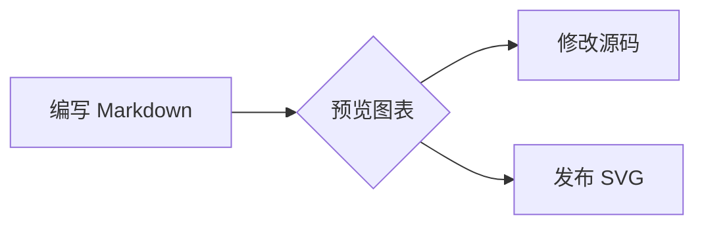

# Pele 图表

Nexusdown 使用 [Pele](https://github.com/obsidianmd/pele) 1.7.0 渲染 `mermaid` 代码块。内容继续保存为 Mermaid 源码，Pele 负责生成 SVG；无需安装或加载 Mermaid.js。

````markdown

````

Pele 支持 Mermaid 的多种图表语法，包括流程图、时序图、类图、状态图、ER 图、饼图、甘特图和思维导图。布局、字体和部分样式与 Mermaid.js 不同，语法范围以 [Pele 兼容说明](https://github.com/obsidianmd/pele#compatibility) 为准。

## 编辑

顶层图表代码块在编辑器中显示预览。点击图表，或聚焦图表后按 Enter / 空格，可以编辑完整源码；点击块外正文后恢复预览。无效、尚未写完或超过渲染限制的内容保留为可编辑源码，不会阻断整篇文档。

页签中的图表沿用页签交互。引用和列表中的图表在编辑器中保留代码形式，发布侧仍可渲染 SVG，以避免整行替换隐藏父级 Markdown 标记。

## 输出与 SSR

```ts
import { renderMarkdown } from '@nexusmc-cn/nexusdown/render'
import '@nexusmc-cn/nexusdown/dialect.css'

const html = renderMarkdown(markdown, { diagramIdPrefix: 'article-42' })
```

`renderMarkdown()` 保持同步，可在没有 DOM 的 Node 环境中输出 SVG。同一份文档内的图表 ID 自动区分；同一页面输出多个 Markdown 片段时，为各片段提供不同且稳定的 `diagramIdPrefix`，SSR 与客户端使用相同值。编辑器 widget 的前缀自动隔离。

SVG 文本尺寸采用服务端和浏览器共用的估算器，避免浏览器 canvas 与服务端测量不同导致首次渲染几何不一致。甘特图的“今天”标记仍使用渲染当时的日期。

图表颜色通过 `--pele-*` 映射到现有 `--nd-*` 主题变量。可以在页面容器上调整 Nexusdown 的颜色变量，也可用更具体的 `.nd-diagram` 样式覆盖 Pele 变量。

## 渲染边界

图表渲染不发起网络请求。Nexusdown 固定禁用图表内链接、外部图片和用户提供的图标解析器；图表文本无法覆盖这些设置。沿用 Pele 的限制：源码最多 50,000 字符、SVG 最多 4,000,000 字符、流程图最多 5,000 条边。失败时显示代码，不把错误消息作为 HTML 插入。

Pele 的 MIT 及相关声明随 npm 包一起发布，见 `THIRD_PARTY_NOTICES.md`。
